# Tangkapan Layar Gacha Quest

Galeri 18 tangkapan layar semua layar Gacha Quest, diambil dari build `bin/game.exe`
di Windows Terminal (110x32, `GACHA_COLOR=truecolor`, glyph Unicode).

Kondisi sesi saat pengambilan gambar: pemain **Dokumentasi**, seed dunia **12345**,
slot 1 dan 2 berisi save sesi dokumentasi. File runtime di `data/` dikembalikan ke
keadaan semula setelah pengambilan selesai.

Setiap layar memakai footer yang sama: `Up/Down pilih  Enter konfirmasi  Esc kembali`
(bila layar punya menu).

## Menu dan Persiapan

### 1. Menu Utama — `01-menu-utama.png`

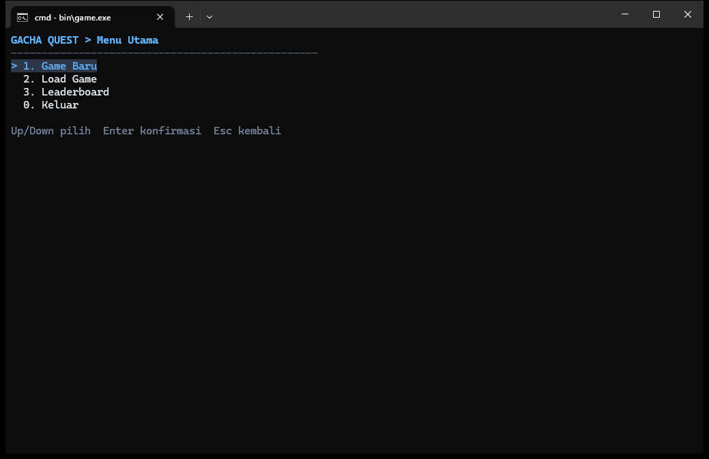

Titik masuk program. Empat pilihan: `Game Baru`, `Load Game`, `Leaderboard`, `Keluar`.
Baris pesan di bawah menu menampilkan hasil aksi sebelumnya, misalnya skor yang baru
dicatat ke leaderboard.

### 2. Game Baru: nama pemain — `02-game-baru-nama.png`

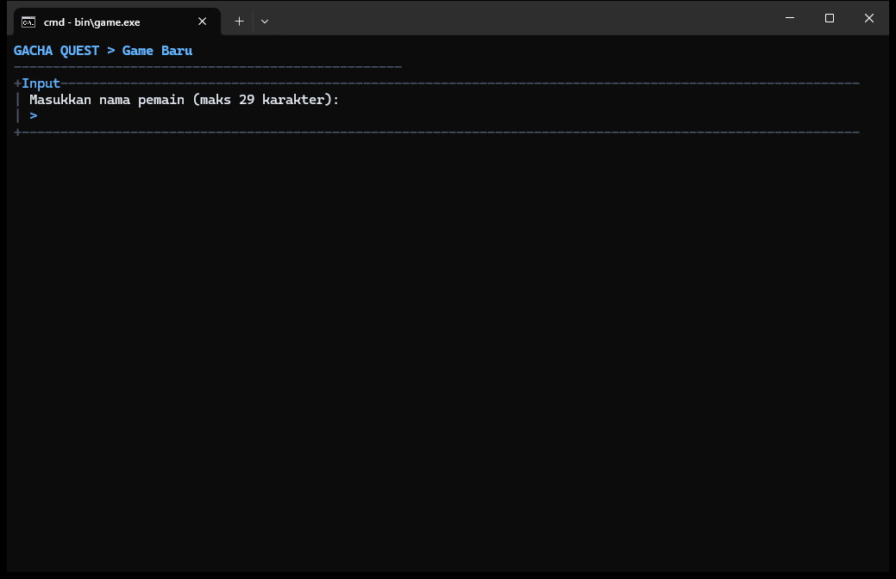

Panel `Input` meminta nama pemain, maksimal 29 karakter. Enter melanjutkan ke
langkah seed; Esc membatalkan dan kembali ke menu utama.

### 3. Game Baru: seed dunia — `03-game-baru-seed.png`

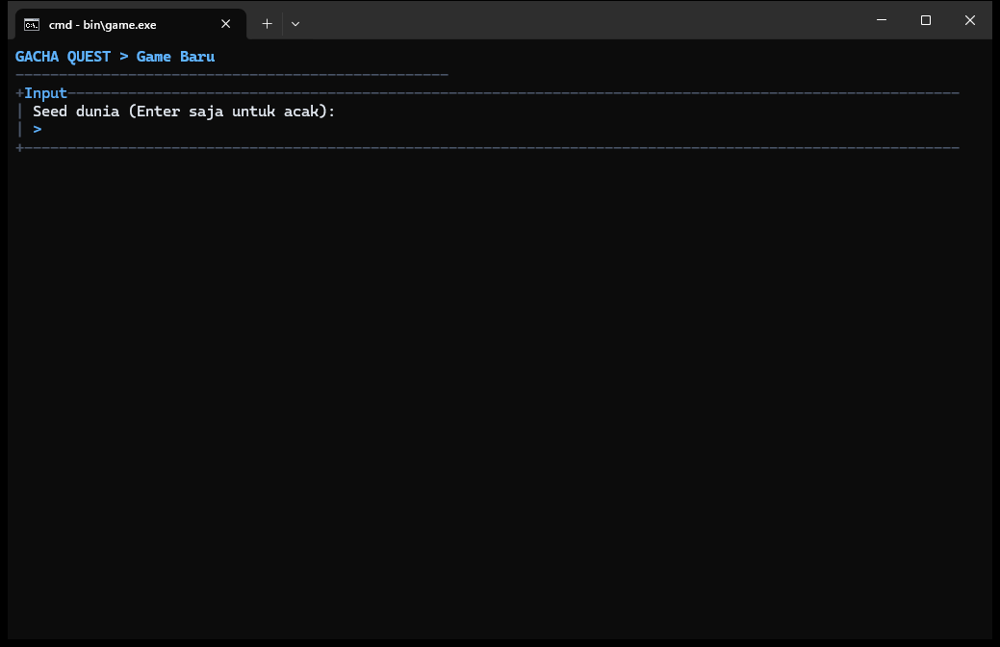

Seed menentukan dunia prosedural dungeon. Enter dengan isian kosong memilih seed
acak, angka di luar rentang 0 sampai 4294967295 ditolak dan diminta ulang.

### 4. Load Game — `04-load-game.png`

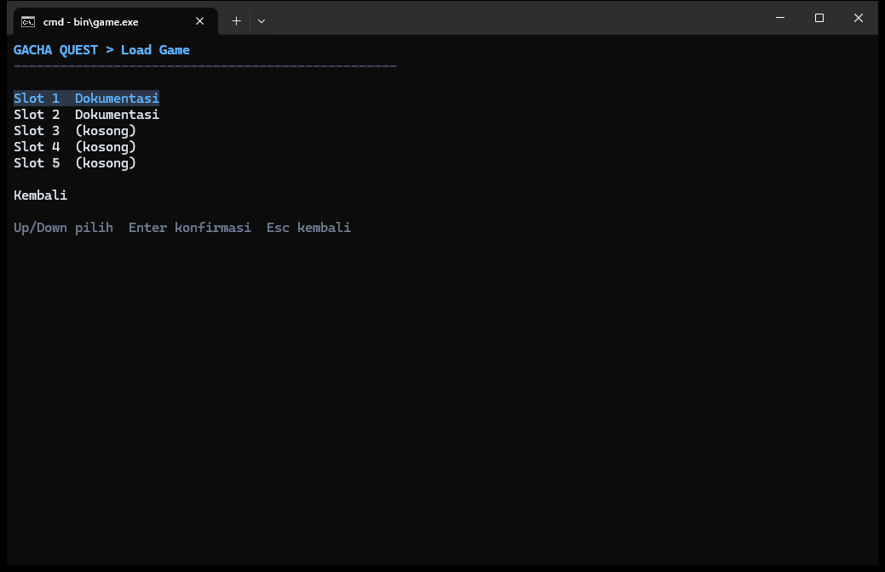

Pemilih slot: lima slot ditambah baris `Kembali`. Slot kosong ditandai `(kosong)`
dan tidak bisa dimuat. Slot yang berisi menampilkan nama pemain dan level.

### 5. Hub — `05-hub.png`

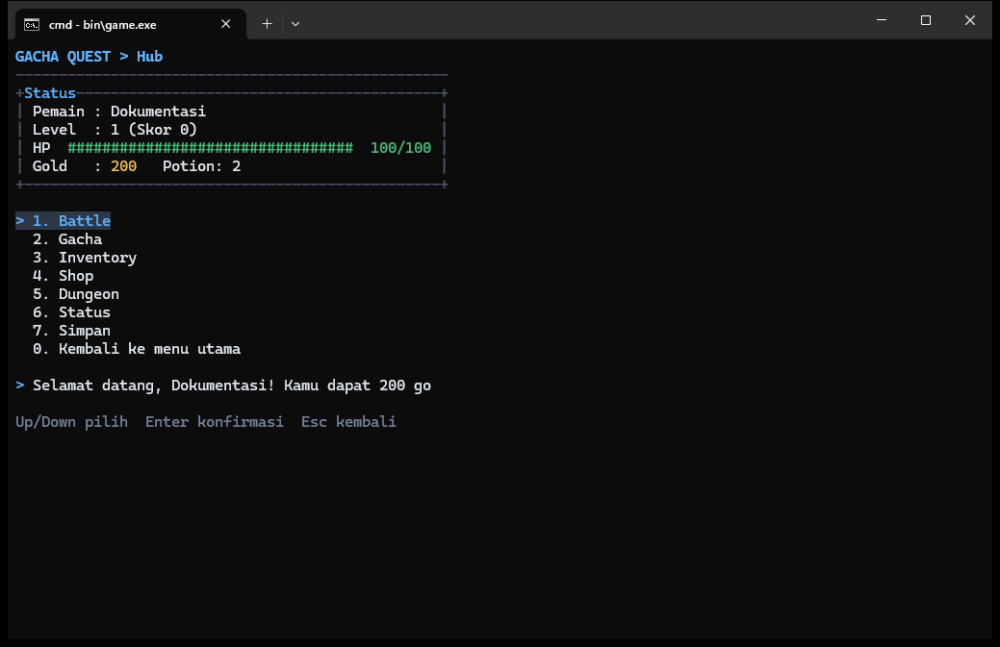

Pusat permainan setelah nama dan seed diisi. Panel status menampilkan nama, level,
HP, gold, potion, dan skor. Delapan pilihan: Battle, Gacha, Inventory, Shop, Dungeon,
Status, Simpan, kembali ke menu utama.

## Layar Permainan

### 6. Status — `06-status.png`

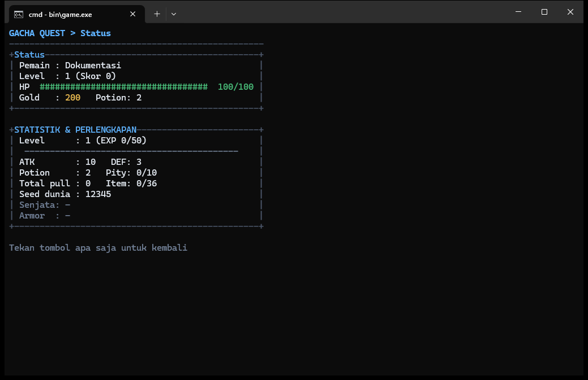

Ringkasan statistik pemain: level, HP, ATK/DEF (termasuk bonus equip), gold, potion,
skor, serta item yang sedang dipakai.

### 7. Battle — `07-battle.png`

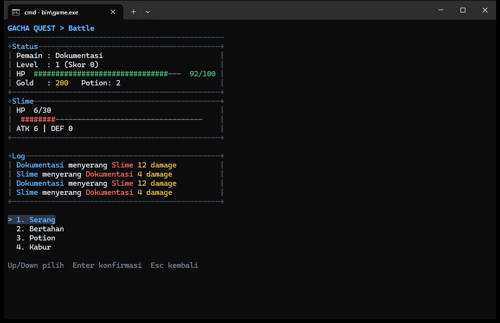

Pertarungan giliran melawan monster sesuai level. HP kedua pihak tampil sebagai bar,
panel bawah mencatat setiap serangan. Aksi: `A` serang, `D` bertahan, `P` potion,
`R` kabur (atau angka 1-4 di menu aksi).

### 8. GAME OVER — `08-game-over.png`

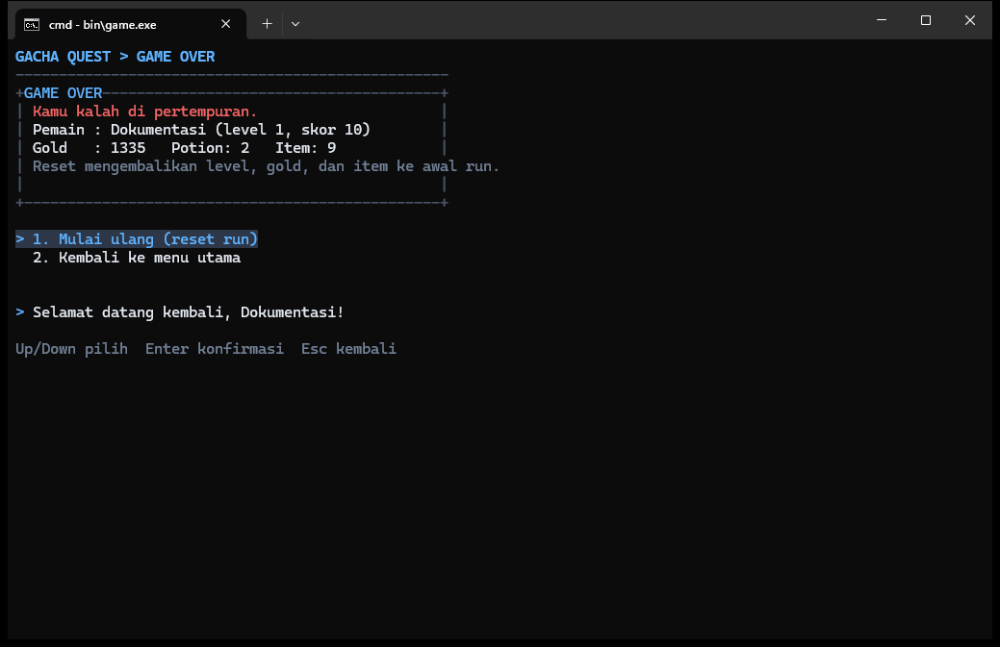

Muncul saat HP pemain habis. Menampilkan nama, level, skor, gold, potion, dan jumlah
item terakhir. Pilihan `Mulai ulang` mereset run ke kondisi awal; `Kembali ke menu
utama` keluar tanpa reset.

### 9. Gacha — `09-gacha.png`

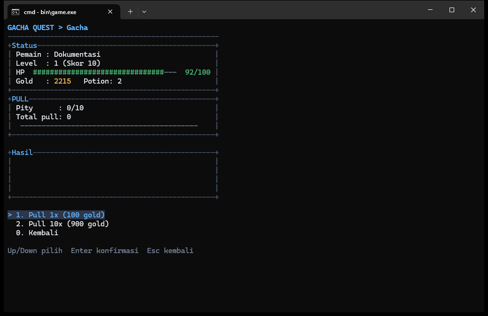

Menu tarikan: `Pull 1x (100 gold)`, `Pull 10x (900 gold)`, `Kembali`. Panel menampilkan
gold saat ini, pity counter, dan total pull.

### 10. Hasil Gacha 10x — `10-gacha-hasil-10x.png`

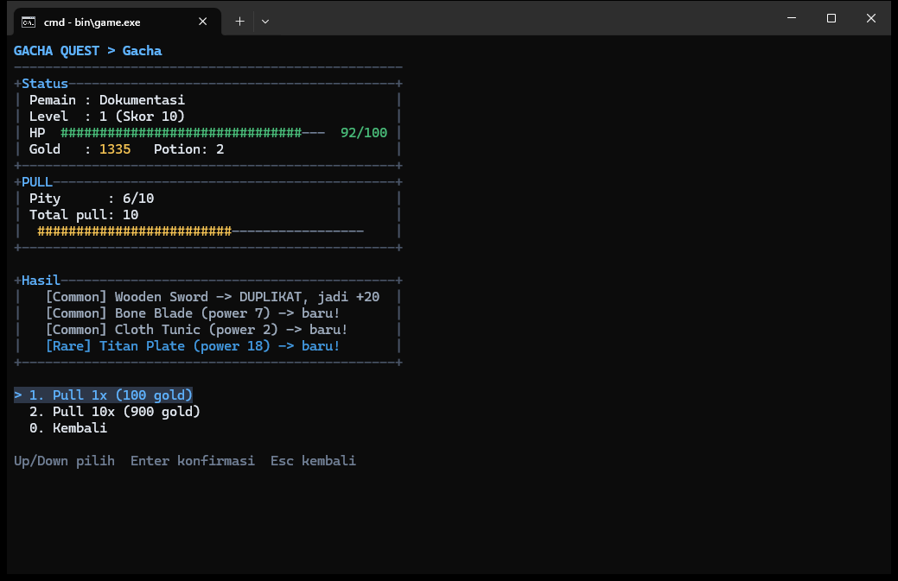

Sepuluh baris hasil tarikan berurutan. Setiap baris menampilkan rarity (Common, Rare,
Epic, Legendary), nama item atau bonus gold/potion, dan keterangan statistiknya.

### 11. Inventory kosong — `11-inventory-kosong.png`

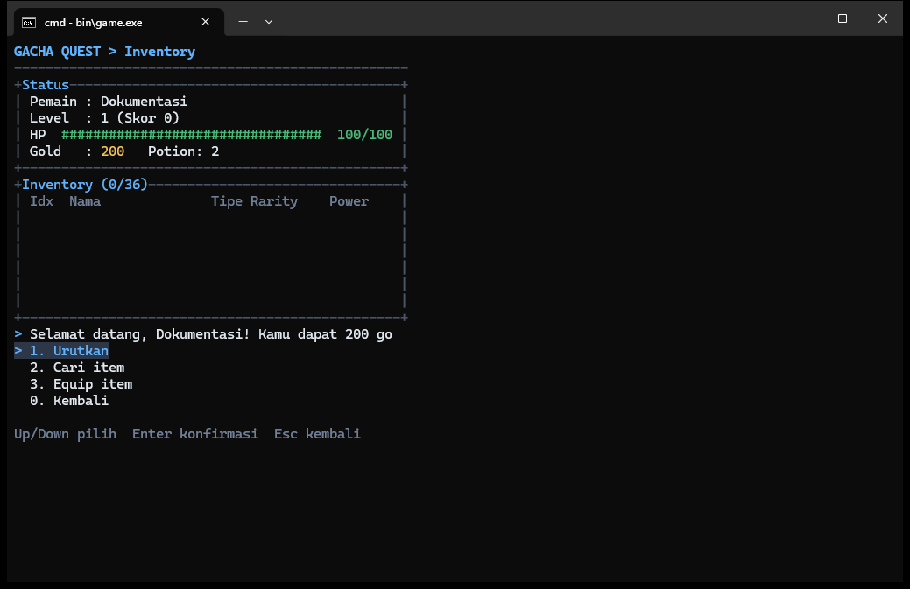

Inventory sebelum ada item: judul `Inventory (0/36)` dan panel daftar kosong. Menu
aksi tetap tampil: `Urutkan`, `Cari item`, `Equip item`, `Kembali`.

### 12. Inventory berisi — `12-inventory.png`

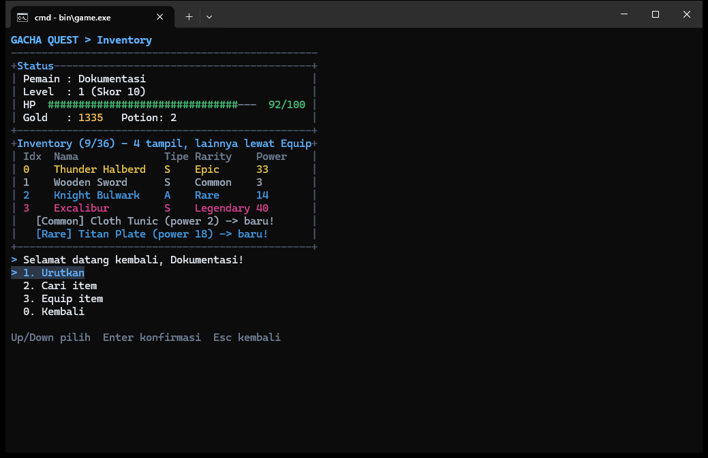

Daftar item dengan rarity berwarna, status terpakai, dan jumlah tampil. Baris
terpilih bisa langsung di-equip dari menu `Equip item`.

### 13. Equip Item — `13-equip-item.png`

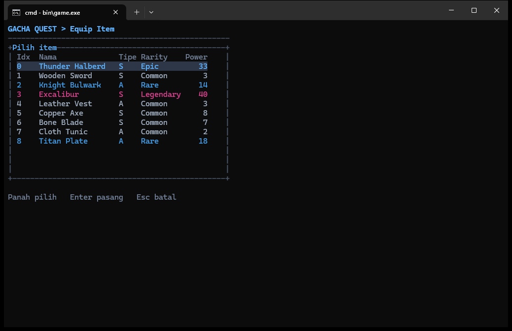

Pemilih item untuk dipakai sebagai senjata (`S`) atau armor (`A`), dengan kolom
rarity berwarna dan nilai power. Enter memasang item yang dipilih dan langsung
memperbarui ATK/DEF pemain; Esc membatalkan.

### 14. Shop — `14-shop.png`

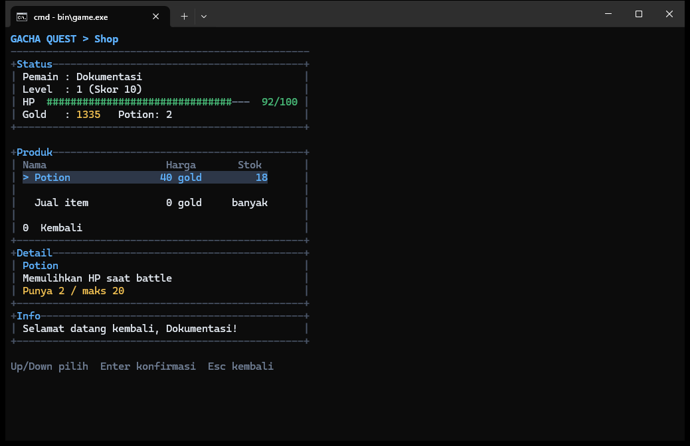

Toko hub: `Potion` (40 gold, menambah 1 potion) dan `Jual item` (masuk ke layar jual).
Baris `Kembali` menutup toko. Gold saat ini tampil di panel status atas.

### 15. Jual Item — `15-jual-item.png`

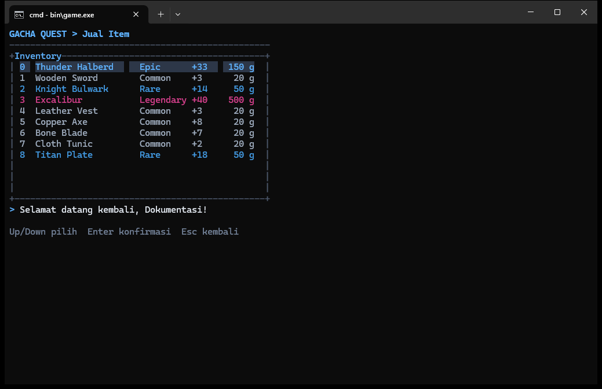

Daftar item inventory beserta harga jual. Konfirmasi `Jual <nama> seharga <N> gold? (y/n)`
mencegah penjualan tidak sengaja.

### 16. Dungeon — `16-dungeon.png`

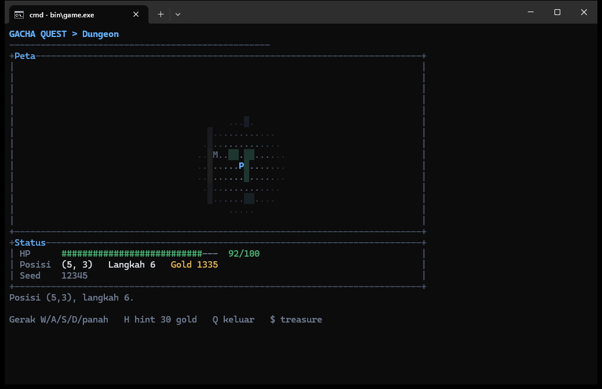

Peta prosedural dengan fog of war: hanya area sekitar pemain yang terlihat. Footer
menyebut kontrolnya: gerak `W`/`A`/`S`/`D` atau panah, `H` hint seharga 30 gold,
`Q` keluar, `$` treasure. Panel Status menampilkan HP, posisi, langkah, gold, dan
seed; panel Log mencatat isi sel yang ditemukan.

## Penyimpanan dan Papan Skor

### 17. Simpan Game — `17-simpan-game.png`

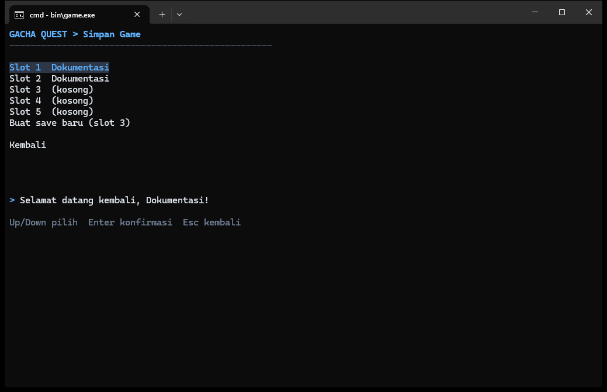

Pemilih slot untuk menyimpan. Slot terisi menampilkan nama pemain dan level; slot
kosong menawarkan `Buat save baru`. Enter menyimpan, Esc membatalkan.

### 18. Leaderboard — `18-leaderboard.png`

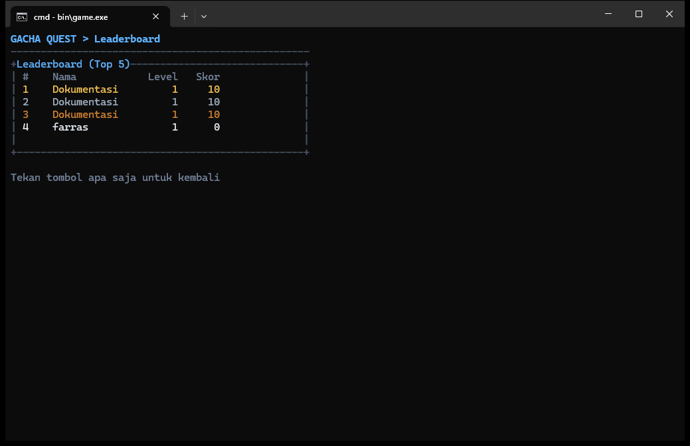

Top 5 skor dari `data/leaderboard.txt`: nama, level, dan skor. Tekan tombol apa saja
untuk kembali ke menu utama.
